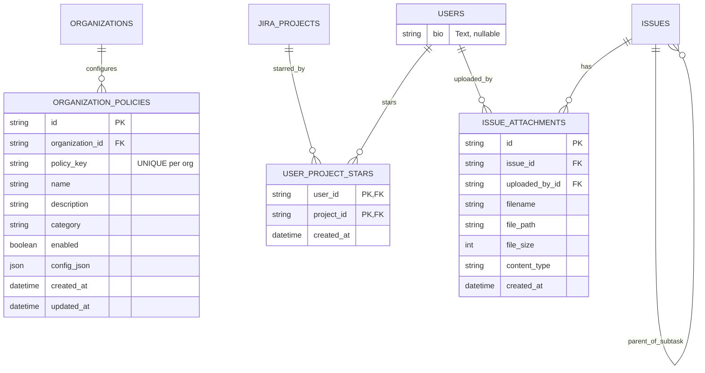

# Đặc tả Kỹ thuật & Kế hoạch Triển khai: Chuyển đổi Mock sang Real API (Axiom DX-OS)

---

## 1. Tóm tắt Phạm vi & Mục tiêu (Understanding Summary)
* **Mục tiêu:** Chuyển đổi toàn diện 5 cụm tính năng đang lưu tạm qua `localStorage` (Mock) và chuẩn hóa 2 cụm API bán thực (Hybrid fallback) thành API thật 100%, có cơ sở dữ liệu PostgreSQL/SQLite bền vững và phân quyền chuẩn Enterprise.
* **Đối tượng người dùng:**
  - **Owner / Admin:** Quản trị chính sách doanh nghiệp tập trung (Governance Policies) và Giám sát an ninh chuẩn xác (SOC Security Summary).
  - **Manager & Member:** Quản lý tệp đính kèm nhiệm vụ (Task Attachments), việc con phân cấp (Subtasks), và ghim không gian dự án (Starred Jira Spaces).
  - **Toàn bộ nhân sự:** Cập nhật tiểu sử cá nhân (`bio`) đồng bộ trên cơ sở dữ liệu.
* **Ràng buộc hệ thống (Key Constraints):**
  - Đảm bảo tính đa tổ chức (Multi-tenancy isolation) theo `organization_id`.
  - Không phá vỡ (Zero regression) các tính năng hiện có: LiveKit WebRTC, Babel Fish STT, Pipeline AI Ollama, và Tuyển dụng.
  - Tệp đính kèm lưu trữ trên volume nội bộ máy chủ (`/app/storage/attachments`) có giới hạn 25MB/tệp.
* **Mục tiêu loại trừ (Explicit Non-Goals):**
  - Không can thiệp pipeline xử lý âm thanh WebRTC hay mô hình LLM.
  - Chưa sử dụng Cloud S3 ngoài để giữ nguyên tính On-Premise tuyệt đối của Axiom.

---

## 2. Các Giả định Kỹ thuật (Assumptions)
1. **Lưu trữ tệp:** Sử dụng phân vùng volume cục bộ của Docker (`storage/attachments`) và lập chỉ mục qua bảng `issue_attachments`. Tên tệp vật lý được bọc mã UUID để chống trùng lặp và tấn công Path Traversal.
2. **Kích thước & Định dạng:** Giới hạn 25MB cho mỗi tệp đính kèm. Hỗ trợ tài liệu (PDF, DOCX, XLSX, TXT) và hình ảnh/nén (PNG, JPG, ZIP).
3. **Mặc định chính sách:** Khi một tổ chức được khởi tạo, hệ thống tự động gieo các chính sách quản trị chuẩn (Agenda Gate bắt buộc, thời lượng tối đa, v.v.).

---

## 3. Nhật ký Quyết định Kiến trúc (Decision Log)
* **Quyết định 1:** Lựa chọn **Hướng tiếp cận 1 (Bounded Context Integration)** để bảo đảm toàn vẹn quan hệ cơ sở dữ liệu, sử dụng Foreign Keys và type-safety thay vì giải pháp lưu trữ JSONB tự do.
* **Quyết định 2:** Toàn bộ công việc chuyển đổi được thực hiện độc lập trên nhánh Git **`feature/replace-mock-with-real-apis`**.
* **Quyết định 3:** Tái sử dụng quan hệ đệ quy `parent_id` sẵn có trong bảng `issues` của Jira backend để chuẩn hóa tính năng Subtask cho toàn bộ các giao diện Kanban.
* **Quyết định 4:** Loại bỏ hoàn toàn số liệu giả lập (pseudo-mock) trong SOC Security Summary để trả về dữ liệu sự kiện thực tế từ bảng `AuditLog`.

---

## 4. Thiết kế Chi tiết Cơ sở Dữ liệu & Data Models

### 4.1. Entity-Relationship Diagram (ERD)

### 4.2. Alembic Migration Scope
Tạo 1 migration script `add_policies_attachments_stars_and_bio`:
* Tạo bảng `organization_policies` (Index trên `organization_id`, Unique Constraint trên `(organization_id, policy_key)`).
* Tạo bảng `issue_attachments` (Index trên `issue_id`).
* Tạo bảng `user_project_stars` (Composite Primary Key `(user_id, project_id)`).
* Bổ sung cột `bio = Column(Text, nullable=True)` vào bảng `users`.

---

## 5. Đặc tả Chi tiết API Endpoints & Contracts

### 5.1. Governance Policies (`/api/v1/organizations/{org_id}/policies`)
* **`GET /api/v1/organizations/{org_id}/policies`**: Lấy danh sách chính sách của tổ chức (tự động seed nếu rỗng).
  - *Response:* `List[OrganizationPolicyResponse]`
* **`PATCH /api/v1/organizations/{org_id}/policies/{policy_key}`**: Bật/tắt chính sách đơn lẻ (`RoleEnum.OWNER`, `RoleEnum.ADMIN`).
  - *Request:* `{ "enabled": boolean, "config_json": Optional[dict] }`
* **`PUT /api/v1/organizations/{org_id}/policies/batch`**: Cập nhật đồng loạt chính sách từ màn hình Admin.
  - *Request:* `BatchPolicyUpdateRequest(policies: List[PolicyUpdateItem])`

### 5.2. Issue Attachments (`/api/v1/jira/issues/{issue_id}/attachments`)
* **`POST /api/v1/jira/issues/{issue_id}/attachments`**: Tải lên tệp đính kèm (`multipart/form-data`).
  - *Validation:* Kiểm tra quyền thành viên tổ chức, giới hạn dung lượng ≤ 25MB.
  - *Response (201):* `IssueAttachmentResponse(id, issue_id, filename, file_size, content_type, created_at, uploader_name)`
* **`GET /api/v1/jira/issues/{issue_id}/attachments`**: Lấy danh sách tệp đính kèm của một issue.
* **`GET /api/v1/jira/attachments/{attachment_id}/download`**: Tải tệp xuống an toàn (Streaming / FileResponse).
* **`DELETE /api/v1/jira/attachments/{attachment_id}`**: Xóa tệp đính kèm (Người tải lên hoặc Manager/Admin).

### 5.3. Starred Jira Spaces (`/api/v1/jira/user/starred`)
* **`GET /api/v1/jira/user/starred`**: Trả về danh sách `project_id` mà user hiện tại đã gắn sao.
* **`POST /api/v1/jira/projects/{project_id}/star`**: Đánh dấu gắn sao cho dự án.
* **`DELETE /api/v1/jira/projects/{project_id}/star`**: Bỏ đánh dấu gắn sao.

### 5.4. User Bio & Auth Expansion (`/api/v1/auth/me`)
* Mở rộng Schema `UserResponse` và `UserUpdate` với trường `bio: Optional[str] = None`.
* Cập nhật endpoint `PATCH /api/v1/auth/me` để lưu trữ và trả về `bio`.

### 5.5. Chuẩn hóa SOC Security & Audit Summary (`/api/v1/admin/security-summary`)
* Xóa toàn bộ logic fallback số liệu giả `{"CRITICAL": 2, "WARN": 8, "INFO": 45}`.
* Phân loại và tổng hợp trực tiếp từ bảng `AuditLog` theo `organization_id`.
* Trả về đúng số lượng 0 khi không có sự kiện và tính Trust Score theo tỷ lệ cảnh báo nguy hiểm thực tế.

---

## 6. Kế hoạch Triển khai Chi tiết (Phased Implementation Plan)

### Giai đoạn 1: Database Migration & Backend Domain Models
1. **Bước 1.1:** Định nghĩa các model SQLAlchemy trong `src/backend/models.py`:
   - `OrganizationPolicy`, `IssueAttachment`, `UserProjectStar`, và cột `bio` trong `User`.
2. **Bước 1.2:** Tạo và kiểm thử tệp migration Alembic:
   - Chạy `alembic revision --autogenerate` và kiểm tra lệnh SQL DDL.
   - Nâng cấp schema trong container Postgres qua `alembic upgrade head`.

### Giai đoạn 2: Xây dựng Backend Services & API Endpoints
1. **Bước 2.1:** Viết Schemas Pydantic V2 trong `src/backend/schemas/`.
2. **Bước 2.2:** Viết các router và tích hợp vào `src/backend/api/v1/`:
   - `organizations.py`: Endpoints cho Governance Policies.
   - `jira.py`: Endpoints cho Attachments và Starred Spaces.
   - `auth.py`: Cập nhật xử lý `bio`.
   - `admin.py`: Chuẩn hóa `security-summary` loại bỏ dữ liệu ảo.
3. **Bước 2.3:** Viết bộ kiểm thử tự động Pytest xác minh 100% các endpoint mới.

### Giai đoạn 3: Tích hợp Frontend Client & Loại bỏ LocalStorage
1. **Bước 3.1:** Cập nhật `src/frontend/src/lib/api.ts` với đầy đủ type definitions và API methods tương ứng.
2. **Bước 3.2:** Thay thế `localStorage` trong `ProtocolPoliciesTab.tsx` bằng API policies.
3. **Bước 3.3:** Thay thế `localStorage` trong `ManagerKanbanTaskTab.tsx` và `MemberJiraWorkspaceTab.tsx`:
   - Chuyển việc con (subtasks) sang gọi API Jira với `parent_id`.
   - Chuyển tệp đính kèm sang gọi API upload/download tệp thật.
4. **Bước 3.4:** Thay thế `localStorage` trong `JiraSidebar.tsx` với API Starred Spaces.
5. **Bước 3.5:** Cập nhật `UserProfileModal.tsx` để đồng bộ `bio` trực tiếp qua Auth API.

### Giai đoạn 4: Kiểm thử E2E & Tái build Container
1. **Bước 4.1:** Kiểm thử thực tế trên giao diện:
   - Thử nghiệm trên 2 trình duyệt độc lập hoặc cửa sổ ẩn danh để đảm bảo dữ liệu (chính sách, subtask, file đính kèm, sao dự án) đã đồng bộ 100% qua server.
2. **Bước 4.2:** Tự động thực thi quy tắc build lại container:
   - `docker compose up -d --build frontend`
3. **Bước 4.3:** Xác minh trạng thái hệ thống và bàn giao cho người dùng.
